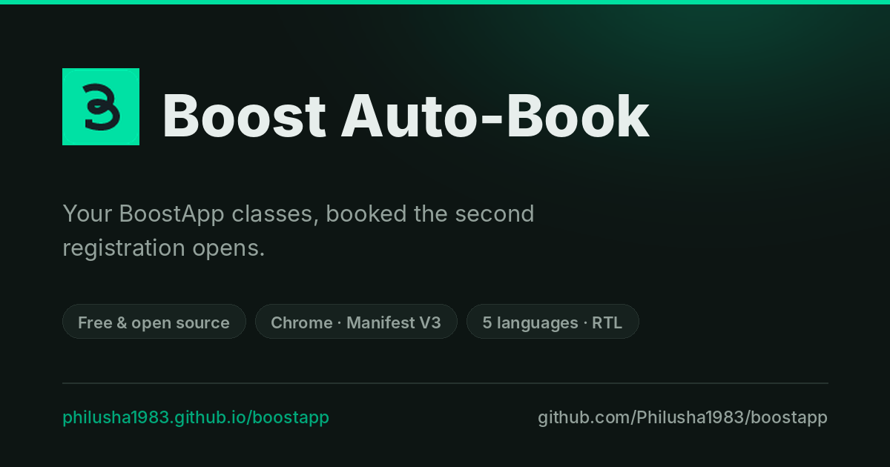
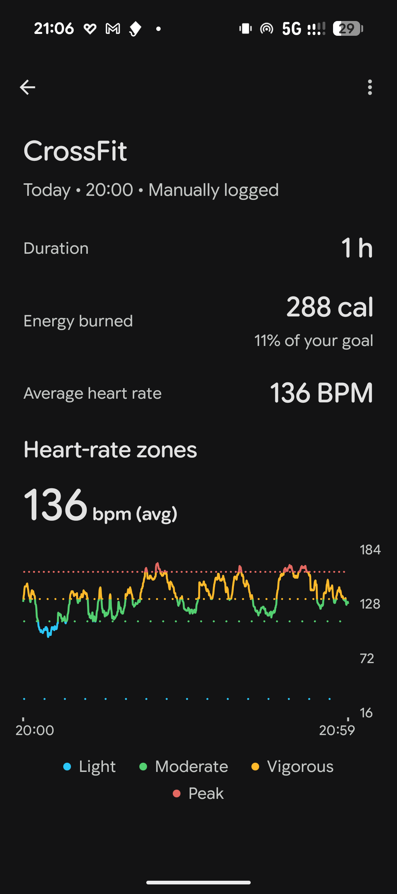
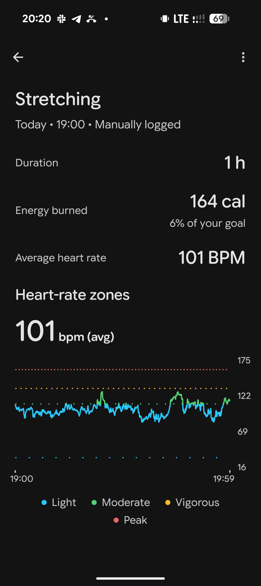
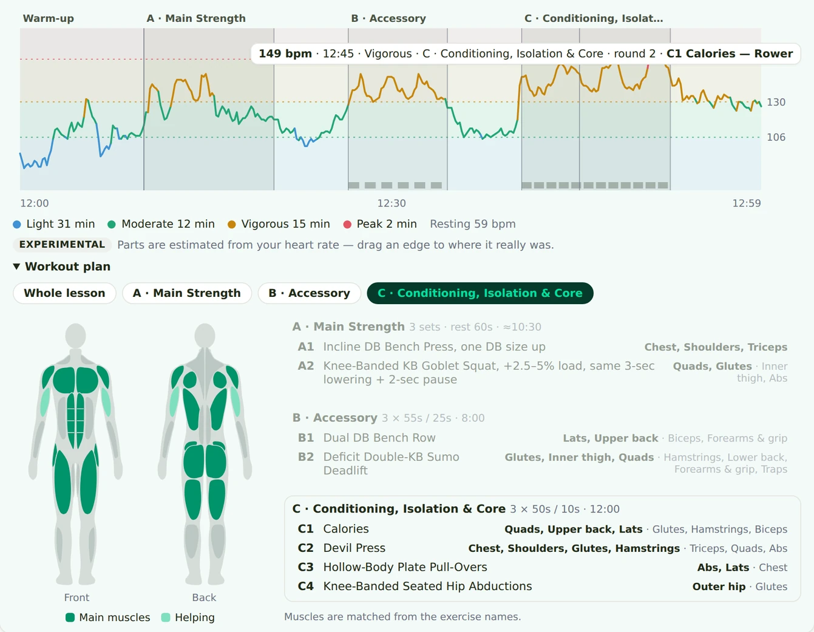
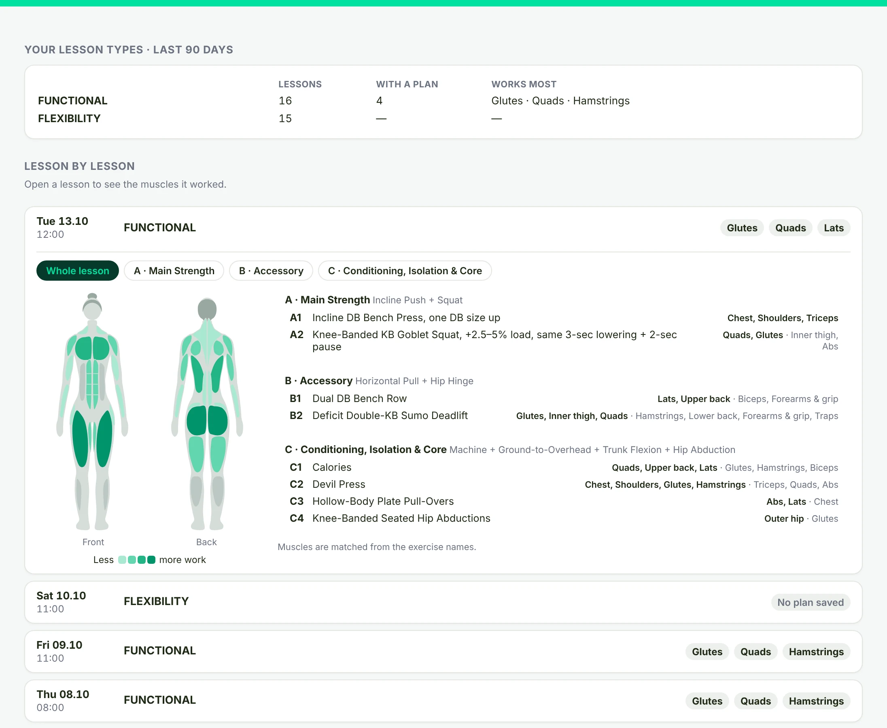

# Boost Auto-Book

**Your BoostApp classes, booked the second registration opens.**

A free, open-source Chrome extension that watches your favorite BoostApp group
lessons and registers you automatically the instant your studio's registration
window opens — no more refreshing the page at midnight.

**[🌐 Website & easy install guide](https://philusha1983.github.io/boostapp/)** ·
**[⬇ Download](https://github.com/Philusha1983/boostapp/releases/latest)** ·
**[📝 Changelog](CHANGELOG.md)** ·
**[💬 Feedback](https://github.com/Philusha1983/boostapp/issues/new)**

<!-- HERO SCREENSHOT SLOT ---------------------------------------------------
     The banner above is a brand card, not the product. Replace it with a real
     screenshot of the popup as soon as you have one:
       - weekly slots visible, one of them counting down to its registration window
       - light theme, ~1200px wide, saved as docs/assets/popup.png
     It would be the only image in this README that shows the thing people
     actually install, and it belongs above the feature list.
-------------------------------------------------------------------------- -->

---

## ✨ What it does

- 🎯 **Snipes registration** — fires the exact moment your studio's booking window opens, with fast retries until it succeeds
- 📅 **Weekly slots** — tick the classes you attend every week and they're booked for you again and again
- 🗓️ **Three views** — list, week grid, or a full calendar of your subscription period (with a preview of the next one)
- 💳 **Subscription at a glance** — entries left, daily cap, validity, all synced live
- 📊 **History dashboard** — a "Wrapped"-style page of your past classes with monthly stats, streaks and achievements
- ⌚ **Fitbit & Health Connect sync** — attended lessons are logged to Fitbit automatically minutes after class, with your tracker's heart rate, zones and calories, and flow on to Health Connect for all your health apps
- 📈 **Heart rate, lesson by lesson** — a Health tab with each lesson's heart-rate curve in your own Fitbit zones, with the workout plan laid on top: which part (and in timed parts, which exercise) you were doing at every minute
- 💪 **Muscle map** — which muscles each lesson works, part by part, on a body figure (male, female or neutral) — before you book, after class, and for the whole week
- 🧭 **No tracker needed** — the Health tab works without one: every lesson you attended with the muscles its workout plan worked, per class and lesson by lesson. Connect a tracker later and heart rate, zones and steps appear on top
- 🔔 **Keeps up when the studio changes** — classes get renamed, moved to another hour, added and dropped; the extension compares the weekly schedule to the last one it saw and tells you what changed, and offers to move a weekly slot whose class shifted hour
- 🎓 **Guided tour** — a walkthrough on first run, plus a "What's new" card after every update
- 🌍 **5 languages** — English, Hebrew, Russian, Ukrainian, Arabic, with full RTL support and light/dark themes

  
  &nbsp;&nbsp;
  
   
  <em>Real synced lessons in the Fitbit app — logged automatically, with heart-rate zones and calories from your tracker.</em>

  
   
  <em>A real lesson in the Health tab: the heart-rate curve with the plan's parts on top, and the muscles each part worked.</em>

  
   
  <em>The same tab with no tracker connected — lessons, muscles worked and the full workout plan, all from the studio's posted plan.</em>

Works out of the box with **Training Harmony** (`app.boostapp.co.il`) and is
configurable for any BoostApp studio. Full feature and technical details:
[`boost-autobook/README.md`](boost-autobook/README.md) and
[`boost-autobook/DOCUMENTATION.md`](boost-autobook/DOCUMENTATION.md).

## 🚀 Install (2 minutes)

The friendly step-by-step guide lives on the
**[website](https://philusha1983.github.io/boostapp/)**. The short version:

1. Download the zip from the [latest release](https://github.com/Philusha1983/boostapp/releases/latest) and unzip it into a folder you'll keep
2. Open `chrome://extensions` in Chrome
3. Turn on **Developer mode** (top corner)
4. Click **Load unpacked**, choose the unzipped folder, pin the icon — done

Then open BoostApp, sign in once, and the extension takes it from there.
It checks for updates daily and shows a banner in the popup when a new
version is out.

## ⚠️ Disclaimer

Boost Auto-Book is an **independent, unofficial project**. It is not made by,
affiliated with, or endorsed by Boost / BoostApp (Training Harmony) or any
studio.

Nothing is hacked and nothing shady happens: the extension only uses the same
data the BoostApp website itself shows you once you sign in, and everything it
does — registering, cancelling, viewing your history — is something you could
do by hand on the website. It just does it faster, and while you sleep.

## 🔒 Privacy

No servers, no analytics, no accounts. Everything the extension knows —
including your class history, which is fetched from your own profile — lives
**only in your browser's local storage on your computer**. It is never
uploaded, shared, or sent anywhere. The code is open source, so anyone can
verify this.

## 📄 License

[GPL-3.0](LICENSE). You are free to use, study, modify and share it. If you
distribute a modified version, it has to stay open under the same license.

---

## 🛠 For developers

Repo layout: `boost-autobook/` is the extension (MV3), `boost-autobook/standalone/`
is an extension-free history dashboard (bookmarklet), `docs/` is the GitHub Pages
website, `scripts/build.sh` builds the versioned release zip into `dist/`.

**Versioning** — `boost-autobook/manifest.json` `version` is the single source
of truth (SemVer): patch = fixes · minor = features · major = anything that
changes stored user data (bump `SCHEMA_VERSION` in `background.js` and add a
migration in `migrateSchema()`).

**Releasing:**

1. Add a `WHATS_NEW["x.y.z"]` entry in `boost-autobook/walkthrough.js`
   (5 languages; optionally a tour step tagged `addedIn`) — users see it once
   after updating
2. Bump `version` in `manifest.json`; move `[Unreleased]` notes in
   `CHANGELOG.md` into a new `[x.y.z] — date` section
3. Commit, tag `vX.Y.Z`, push with tags — the tag triggers
   `.github/workflows/release.yml`, which builds the zip and publishes the
   GitHub Release (tag must match the manifest version)

Installed extensions surface the new version via the daily update check.
To build a zip locally without releasing: `./scripts/build.sh` → `dist/`.

**Feedback** — GitHub Issues. The popup's Feedback link opens a prefilled
issue including the user's extension version and browser.
